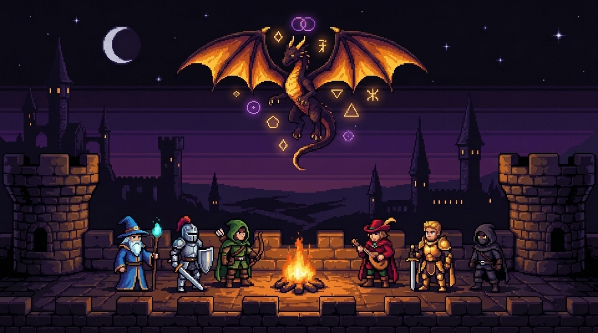
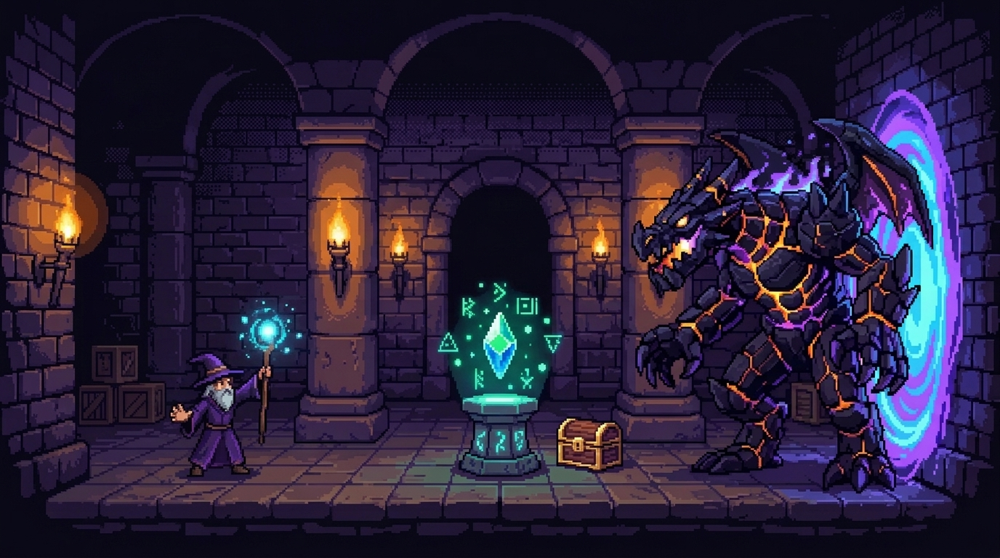

<div align="center">



# 🐉⚔️ Code & Dragons: Crónicas del Frontend

**Videojuego RPG de acción y plataformas 2D en Pixel Art estilo *Calabozos y Dragones* para dominar JavaScript, el DOM, Asincronía y Arquitectura Frontend conquistando 6 castillos temáticos.**

🏰 **6 Castillos · 24 Salas · 6 Jefes** &nbsp;|&nbsp; 🧙 **6 Clases D&D** &nbsp;|&nbsp; 💻 **Sandbox JS & DOM en vivo** &nbsp;|&nbsp; 🎵 **Audio Chiptune 8-bit**

</div>

---

## ✨ Características Principales

- 🏰 **6 Castillos Temáticos (24 Salas + 6 Jefes):** Progresión curricular desde fundamentos de JavaScript hasta arquitectura Frontend con patrón Pub-Sub, `localStorage` y `debounce`.
- 🧙‍♂️ **6 Clases D&D Jugables:** Cada clase modifica tus estadísticas físicas (`HP`, `Maná`/`Energía`, velocidad, salto, Doble Salto o Dash) y adapta las pruebas de código de los altares.
- 🎮 **Motor de Plataformas 2D en HTML5 Canvas:** Física en tiempo real, plataformas sólidas, semisolidas, móviles, puentes y compuertas rúnicas vinculadas a altares, trampas (`spikes`, `lava`), 4 arquetipos de enemigos (`patrol`, `orbiter`, `turret`, `charger`), cofres y hogueras de guardado.
- 🧪 **Sandbox de Código Dual (`console` y `dom`):**
  - 🖥️ **Modo Consola (Castillos 1–3):** Captura de `console.log`/`warn`/`error` y batería de pruebas unitarias en tiempo real.
  - 🪞 **Espejo Arcano DOM (Castillos 4–6):** Contenedor HTML/CSS aislado con `document` encapsulado para manipular el DOM sin afectar la interfaz del juego, `fetch()` simulado (`https://api.reino.dev/*`) y `localStorage` aislado.
  - 🛡️ **Protección de Ejecución:** Instrumentación anti-bucles infinitos (`MAX_LOOP_STEPS = 25000`) y timeout de `3000 ms`, con diagnóstico narrativo de errores (`SyntaxError`, `ReferenceError`, `TypeError`).
- 🩸 **Sistema RPG Táctico:** Gestión de **Maná / Energía**, **Pacto de Sangre** (sacrificio voluntario de HP cuando no alcanza el recurso), **Oráculo** de 3 pistas progresivas, **Taberna** con consumibles, **Grimorio** de 24 páginas desbloqueables y guardado automático en `localStorage` (`code_and_dragons_save_v1`).
- 🎵 **Audio Chiptune 8-bit Procedural:** Sintetizador Web Audio API integrado (`soundEngine.ts`) sin archivos de audio externos.
- 🎨 **Gráficos 100% Pixel Art Procedural:** Sprites `16×16` y `24×24` renderizados por matriz en Canvas (`pixelSprites.ts`). Consulta toda la huella gráfica en [`DESIGN.md`](DESIGN.md).

---

## 🗺️ Guía del Aventurero

<div align="center">



*Enfréntate a los guardianes del código en cada cámara: resuelve los Altares Rúnicos para desbloquear puentes, debilitar a los Jefes y abrir el Portal de Salida.*

</div>

### 🧭 1. Flujo de Juego

1. 🌙 **Pantalla de Título:** Inicia una nueva crónica, continúa tu partida guardada o activa el **Modo Exploración Libre** para acceder a los 6 castillos sin restricciones de desbloqueo.
2. ⚔️ **Selección de Clase:** Elige tu nombre de héroe y una de las 6 clases según tu estilo de juego y nivel de reto deseado.
3. 🗺️ **Mapa del Reino (`WorldMap`):** Selecciona un castillo desbloqueado, visita la **Taberna** para comprar pociones/pergaminos con el oro ganado o consulta el **Grimorio** (`G`).
4. 🐉 **Exploración de Salas:** Recorre las 4 salas de cada castillo (la Sala 4 es el **Trono del Jefe**). Resuelve los **Altares de Código** para abrir compuertas/puentes, dañar al Jefe y desbloquear el **Portal de Salida**.

### 🎮 2. Controles

| Acción | Teclado | Notas |
| --- | --- | --- |
| 🏃 Moverse | `A` / `D` o `←` / `→` | Movimiento horizontal |
| 🦘 Saltar / Doble Salto | `W`, `↑` o `Espacio` | Doble salto exclusivo del **Bardo** |
| 💨 Dash Táctico | `Shift` | Exclusivo del **Pícaro** |
| 🔮 Interactuar | `E` o `Enter` | Abrir Altares, Cofres, Hogueras o cruzar Portales |
| ❤️ Poción de Sangre de Dragón (+50 HP) | `1` | Uso rápido durante la exploración |
| 💙 Elixir de Éter / Vigor (+50 Recurso) | `2` | Uso rápido durante la exploración |
| 🛡️ Amuleto de Sintaxis (Escudo 50%) | `3` | Reduce a la mitad el próximo contraataque por error |
| 📖 Abrir / Cerrar Grimorio | `G` | Disponible en el Mapa y en Sala |
| 🔊 Silenciar / Activar Audio | `M` | Alterna efectos y música chiptune |
| ⏸️ Pausa | `P` o `Esc` | Pausa la simulación o cierra modales |

> 📱 En dispositivos móviles o pantallas táctiles puedes activar los **controles táctiles en pantalla** desde el HUD.

### 🧙 3. Clases Disponibles

| Clase | Recurso | HP / Rec. Base | Habilidad Física | Disciplina en Altares de Código |
| --- | --- | --- | --- | --- |
| 🧙‍♂️ **Mago** | 💙 Maná | 80 HP / 120 | Estándar | Plantillas guiadas con pasos comentados y pistas del Oráculo **40% más baratas**. |
| 🛡️ **Guerrero** | 🟠 Energía | 140 HP / 100 | Gran vitalidad | Enfoque en control imperativo, bucles clásicos (`for`/`while`) y mutación controlada. |
| 🏹 **Arquero** | 💙 Maná | 95 HP / 100 | Alta velocidad y salto | Pruebas de precisión en selectores DOM, filtros (`find`/`filter`/`map`) y `fetch`. |
| 🪕 **Bardo** | 💙 Maná | 100 HP / 110 | **Doble Salto** | Retos de eventos (`addEventListener`), sincronización estado-DOM y UX. |
| ⚜️ **Paladín** | 💙 Maná | 130 HP / 100 | Alta resistencia | Agrega **casos borde extra obligatorios** (`null`, `undefined`, vacíos, tipos inválidos). |
| 🗡️ **Pícaro** | 🟠 Energía | 75 HP / 90 | Velocidad máx. + **Dash** | Exige código ES6+ limpio y refactorización (prohíbe declaraciones `var`). |

### 🏰 4. Los 6 Castillos del Currículum

| # | Castillo | Tema Principal | Modo | Jefe |
| --- | --- | --- | --- | --- |
| 1️⃣ | 🔥 **El Bastión de los Orígenes** | Variables, Tipos y Lógica | `console` | Ignis, el Golem de los Tipos Primitivos |
| 2️⃣ | 🐍 **La Fortaleza de los Ciclos** | Bucles, Arrow Functions y Closures | `console` | Ouroboros, la Serpiente del Bucle Infinito |
| 3️⃣ | 📚 **La Ciudadela de las Estructuras** | Destructuring, Spread, `map`/`filter`/`reduce` | `console` | Archivista Malakor, Señor de los Objetos Anidados |
| 4️⃣ | 🕸️ **La Torre del DOM y los Eventos** | `querySelector`, `createElement`, Eventos | `dom` | Aracne, la Reina de la Telaraña del DOM |
| 5️⃣ | ⏳ **El Santuario Asíncrono** | Promesas, `async`/`await`, `fetch()` y Estados de Carga | `dom` | Chronos, el Espectro de la Latencia |
| 6️⃣ | 👑 **El Trono del Arquitecto Frontend** | Store Pub-Sub, `localStorage`, Debounce y App Reactiva | `dom` | El Rey Exánime del Estado Global |

### 🔮 5. Altares, Pacto de Sangre y Taberna

- ⚡ **Ejecutar Conjuro:** Cada ejecución en un Altar consume `castCost` de Maná o Energía (`10` o `12` según la clase).
- 🩸 **Pacto de Sangre:** Si no tienes suficiente Maná/Energía para ejecutar o pedir una pista, el faltante se cobra directamente en **HP** (mínimo `8 HP`).
- 💥 **Contraataque:** Si tu código falla o lanza un error, el guardián del altar contraataca restando HP (`10 + castleId * 2`, más `6` en sala de Jefe). El **Amuleto de Sintaxis** reduce este daño a la mitad.
- 🍺 **Taberna:**
  - ❤️ *Poción de Sangre de Dragón* (`35` 🪙 oro): +50 HP (`[1]`).
  - 💙 *Elixir de Éter Arcano / Ración de Vigor Táctico* (`30` 🪙 oro): +50 Maná/Energía (`[2]`).
  - 📜 *Pergamino de Sabiduría del Oráculo* (`45` 🪙 oro): Revela una pista gratuita en un altar.
  - 🛡️ *Amuleto de Sintaxis* (`40` 🪙 oro): Escudo del 50% ante el próximo error de código (`[3]`).

---

## 🧱 Estructura del Proyecto

```text
code-dragons/
├── index.html                      # 📄 Metadatos, Google Fonts y punto de entrada
├── package.json                    # 📦 Dependencias y scripts de Vite / TypeScript
├── vite.config.ts                  # ⚡ Configuración Vite + Tailwind v4
├── tsconfig.json                   # 🔷 Configuración TypeScript (ES2022, react-jsx)
├── DESIGN.md                       # 🎨 Documentación de huella gráfica y estilos
├── docs/images/                    # 🖼️ Ilustraciones Pixel Art para documentación
└── src/
    ├── main.tsx                    # 🚀 Montaje de React 19
    ├── App.tsx                     # 🎛️ Orquestador de pantallas, atajos y modales
    ├── index.css                   # 🖌️ Tokens tipográficos y clases pixel-art
    ├── types/game.ts               # 🧩 Interfaces de estado, currículo, clases y sandbox
    ├── store/useGameStore.ts       # 💾 Contexto global, economía y persistencia localStorage
    ├── assets/
    │   ├── pixelSprites.ts         # 👾 Matrices 16x16 / 24x24 y caché offscreen en Canvas
    │   └── soundEngine.ts          # 🎵 Sintetizador chiptune 8-bit (Web Audio API)
    ├── data/
    │   ├── castlesCurriculum.ts    # 🏰 6 castillos, 24 salas, retos, tests y temas visuales
    │   ├── classesData.ts          # 🧙 Configuración de las 6 clases D&D
    │   ├── grimoireData.ts         # 📖 24 páginas de referencia técnica y tips por clase
    │   └── shopItems.ts            # 🍺 Catálogo de la Taberna
    ├── engine/
    │   ├── PlatformerCanvas.tsx    # 🕹️ Loop 2D, física, colisiones, enemigos y cámara
    │   ├── codeSandbox.ts          # 🧪 Ejecución segura JS/DOM, mock fetch y diagnóstico
    │   ├── gameRules.ts            # ⚖️ Costos, Pacto de Sangre, XP, AABB y adaptación por clase
    │   └── gameRules.test.ts       # ✅ Pruebas unitarias con node:test
    └── components/
        ├── TitleScreen.tsx         # 🌙 Escena animada de título
        ├── ClassSelection.tsx      # ⚔️ Selector de clase y nombre de héroe
        ├── WorldMap.tsx            # 🗺️ Mapa interactivo de los 6 castillos
        ├── GameHUD.tsx             # 📊 HUD superior (HP, recurso, XP, oro, accesos)
        ├── CodeAltarModal.tsx      # 💻 Editor JS con resaltado, autocompletado y Espejo DOM
        ├── GrimoireModal.tsx       # 📚 Compendio buscable de las 24 lecciones
        ├── TavernModal.tsx         # 🛒 Tienda de consumibles
        ├── CastleVictoryModal.tsx  # 🏆 Pantalla de conquista de castillo
        └── SpritePreview.tsx       # 🖼️ Renderizador React de sprites pixel-art
```

---

## 🚀 Instalación y Desarrollo

### 📋 Requisitos
- **Node.js** >= 18 y **npm**.

### 🛠️ Comandos

```bash
# 📦 Instalar dependencias
npm install

# 🔥 Iniciar servidor de desarrollo (puerto 3000)
npm run dev

# 🔍 Verificar tipos TypeScript
npm run lint

# 🧪 Ejecutar pruebas unitarias de reglas del juego
npx tsx --test src/engine/gameRules.test.ts

# 🏗️ Compilar para producción
npm run build

# 👀 Previsualizar build de producción
npm run preview
```
